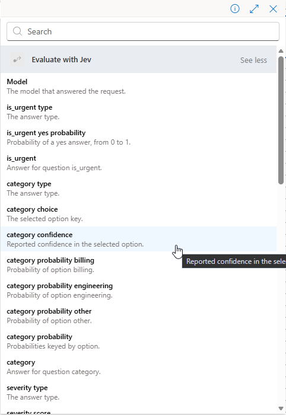

# TypeSafe Jev custom connector

**Fast AI decisions, directly in Power Automate and Copilot Studio.**

This open-source custom connector brings [TypeSafe AI's Jev](https://typesafe.ai/) to Power Platform makers without writing API integration code. Evaluate a message, route a request, or score a case, then use the answers as named, strongly typed dynamic content in your automation.

[Download the latest managed solution](https://github.com/markus-tobler/jev-custom-connector/releases/latest) · [Usage guide](docs/usage.md) · [Contribute](CONTRIBUTING.md)

## Why Jev?

Jev is TypeSafe AI's first **System One model**, built for fast, focused judgments inside software: identifying intent, assessing urgency, choosing a category, or scoring against a rubric. TypeSafe [reports substantial speed and cost advantages over frontier LLMs on its System One workflow evaluations](https://typesafe.ai/blog/introducing-system-one-models-and-jev). Those results are task-specific, not a claim that Jev is better at every AI task or that a complete Power Platform flow will see the same gains.

You provide text or structured data and define the questions. Jev returns typed answers: a yes/no probability, a choice from a fixed set, or a score against an ordered rubric. Probabilities and confidence values let your automation set explicit thresholds for acting automatically and send uncertain cases for review.

Jev complements rather than replaces prompts and frontier models:

- Use **Jev** for frequent, narrow decisions that should return predictable, machine-readable values.
- Use **prompts and frontier models** when the task requires content generation, open-ended reasoning, summarization, or a conversational response.
- Combine them by using Jev to route or qualify work before a prompt, validate a result after a prompt, or send uncertain cases to a frontier model or a person.

## Why a custom connector?

Calling an API is only part of making a model useful in low-code automation. This connector makes Jev accessible to Power Platform makers, with question configuration in the designer and answers ready to use in conditions, switches, approvals, and agent workflows.

- **Named, strongly typed outputs:** Define questions in the designer and select their answer fields from dynamic content, without manually parsing API responses.
- **Text and structured JSON input:** Evaluate emails, support tickets, form responses, transcripts, or structured records.
- **Three question types:** Ask yes/no questions, choose from named options, or score against an ordered rubric.
- **Native JSON when needed:** Use the JSON-text action for integrations that need to parse the native response themselves.
- **Model selection:** List available models and select an alias or a pinned version.

## Example: route a support request

A support message arrives. One **Evaluate with Jev** action asks three questions:

| Question | Type | Dynamic content you can use |
| --- | --- | --- |
| Does this need an immediate response? | Yes/no (`noul`) | `is_urgent yes probability` |
| Should billing, engineering, or another team handle it? | Choice (`choice`) | `category choice`, `category confidence`, and probability per option |
| How severe is the problem? | Score (`score`) | `severity score`, `severity confidence`, and probability per level |

Use `is_urgent yes probability` greater than `0.8` as an example threshold for urgent routing, switch on `category choice` to select the team, and use confidence values to send uncertain cases for human review. Choose thresholds appropriate to your workflow; typed answers do not guarantee correct decisions.

See the [usage guide](docs/usage.md) for the complete example, including question configuration and expressions.

## Get started

1. Get a Jev API key from the [TypeSafe dashboard](https://console.typesafe.ai/keys).
2. Open the repository's [Releases page](https://github.com/markus-tobler/jev-custom-connector/releases) and download the managed `JevCustomConnector` solution from the [latest release](https://github.com/markus-tobler/jev-custom-connector/releases/latest).
3. Import the managed solution into your Power Platform environment.
4. Create a connection for **TypeSafe Jev v1** and enter the API key.
5. Add **Evaluate with Jev** to a flow, provide the state to evaluate, and define one or more questions.
6. Use the generated answer fields as dynamic content in later actions and conditions.

See the [usage guide](docs/usage.md) for a detailed Power Automate example, question types, input schemas, dynamic outputs, and error handling.

See the [development guide](docs/development.md) to build, test, import, and maintain the connector.

## Use it, share feedback, or contribute

Try the connector in your own workflows and help shape it. [Open an issue](https://github.com/markus-tobler/jev-custom-connector/issues) to report a bug or suggest an improvement. Documentation fixes and pull requests are welcome; see [CONTRIBUTING.md](CONTRIBUTING.md) to get started.

To report a vulnerability, follow [SECURITY.md](SECURITY.md) instead of opening a public issue.

## Disclaimer

This is an independent community project. It is not affiliated with, endorsed by, or supported by TypeSafe AI or Microsoft. TypeSafe, Jev, Microsoft, Power Platform, Power Automate, and Copilot Studio are trademarks of their respective owners. Use of the TypeSafe API is subject to TypeSafe's own terms.

## License

[MIT](LICENSE)
