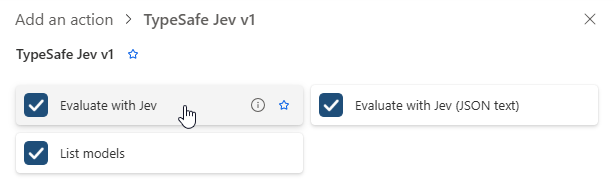
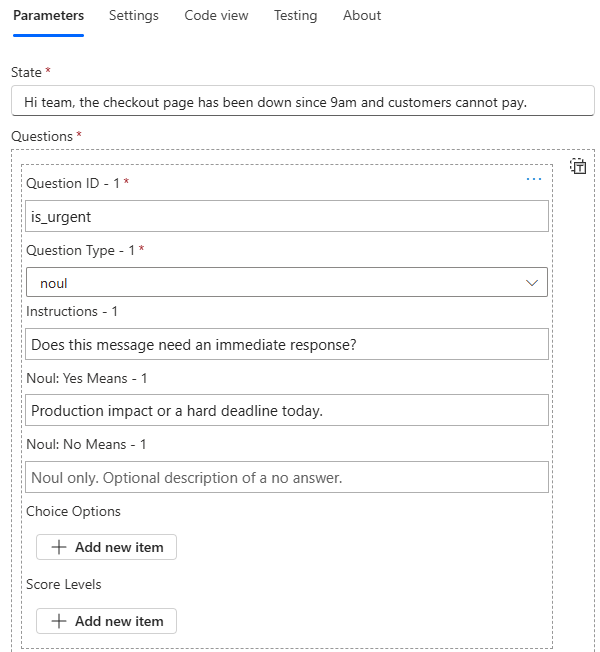
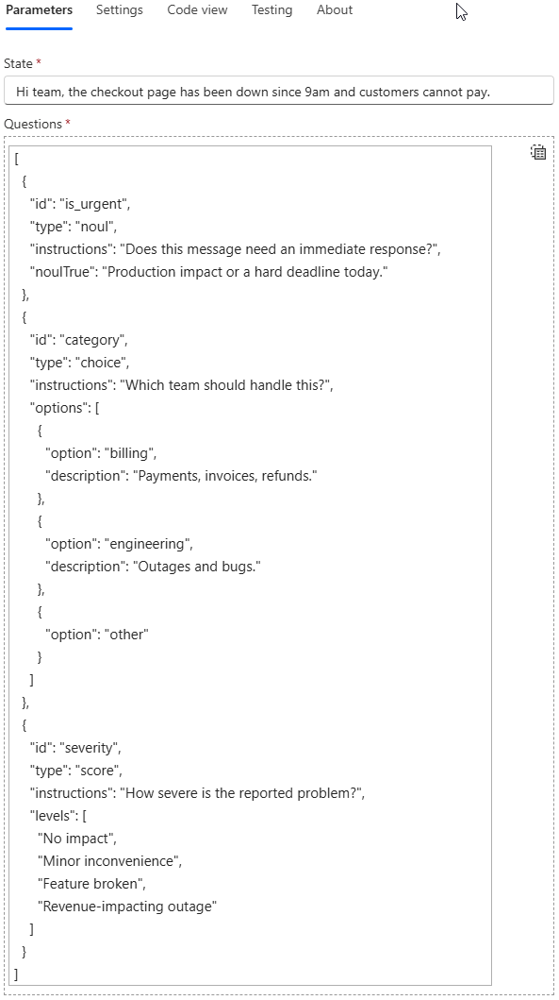

# Using the TypeSafe Jev v1 connector

The connector sends a state and a set of typed questions to TypeSafe AI's Jev model. Jev returns one answer per question, including probabilities that a flow can use for routing, thresholds, approvals, and other automation.

This guide uses Power Automate for the examples. The same connector actions can also be used from other supported Power Platform workflow surfaces and Copilot Studio.

## Before you start

You need:

- The **TypeSafe Jev v1** custom connector installed in your Power Platform environment. Download the managed `JevCustomConnector` solution from the repository's [Releases page](https://github.com/markus-tobler/jev-custom-connector/releases), then import it through Power Apps under **Solutions**.
- A TypeSafe account and API key. Sign in to the [TypeSafe dashboard](https://console.typesafe.ai/keys), create a key, and copy it while it is available.

When Power Automate first asks for a connection, enter the API key in the **TypeSafe API key** field. Store and share the connection as you would any other credential-bearing Power Platform connection.

## Power Automate example

The following example evaluates a support message and asks Jev to decide:

- whether the message is urgent;
- which team should handle it;
- how severe the reported problem is.

### 1. Add the action

Create or edit a cloud flow, add a new action, find **TypeSafe Jev v1**, and select **Evaluate with Jev**.



Use **Evaluate with Jev** when you want strongly typed dynamic outputs. **Evaluate with Jev (JSON text)** returns the native response as text and is intended for surfaces that need to parse the response themselves.

### 2. Enter the state

In **State**, enter the text or dynamic content Jev should evaluate, such as an email body, support ticket, form response, or transcript.

If the complete value is a JSON object or array, the connector sends it as structured JSON. Questions can then refer to fields such as `` `order.total` ``. Other values are sent as text.

### 3. Define the questions

Add one row for each question. Every row displays the fields for all question types; fill in only the fields that apply to the selected type.



| Question type | Use it to | Configuration | Returned answer |
| --- | --- | --- | --- |
| `noul` | Ask a yes/no question | Instructions and optional descriptions of what yes and no mean | Probability from 0 (no) to 1 (yes) |
| `choice` | Select one named option | Instructions and 1-255 unique options, each with an optional description | Selected option, confidence, and probability per option |
| `score` | Rate against an ordered rubric | Instructions and 2-10 level descriptions, lowest level first | Probability-weighted score, confidence, legend, and probability per level |

Use a unique **Question ID** for every row. The ID becomes the key in the API response and the prefix of the generated Power Automate fields, so use short stable names such as `is_urgent`, `category`, and `severity`.

For example:

| ID | Type | Instructions | Type-specific criteria |
| --- | --- | --- | --- |
| `is_urgent` | `noul` | Does this message need an immediate response? | Yes: Production impact or a hard deadline today. |
| `category` | `choice` | Which team should handle this? | `billing`, `engineering`, `other` |
| `severity` | `score` | How severe is the reported problem? | No impact; Minor inconvenience; Feature broken; Revenue-impacting outage |

The default model is `jev-latest`. Open the advanced parameters to select another alias or a pinned version if you need reproducible behavior.

### 4. Use the generated answers

After the questions are defined, later actions can select strongly typed values from **Dynamic content**.


The generated fields depend on the question type:

| Question type | Dynamic outputs |
| --- | --- |
| `noul` | `<id> yes probability` |
| `choice` | `<id> choice`, `<id> confidence`, `<id> probability <option>` |
| `score` | `<id> score`, `<id> confidence`, `<id> probability <n>`, `<id> legend <n>` |

`Model`, `Input tokens`, and `Output tokens` are always available.

For example, a condition can route urgent messages when `is_urgent yes probability` is greater than `0.8`. The equivalent expression is:

```text
@greater(body('Evaluate_with_Jev')?['answers']?['is_urgent']?['noul'], 0.8)
```

For choice and score questions, use confidence to decide whether the flow should act automatically or send the item for review.

If you change the questions in a saved flow, open the action again so the designer refreshes its dynamic output schema.

## Entering questions as JSON

On **Questions**, select **Switch to input entire array** to use an expression, a variable, or JSON directly.



The connector accepts either its row-based schema or the native TypeSafe questions schema.

### Connector row schema: `options` with `option`

The Power Automate-friendly schema is an array. A choice question has an `options` array, and each item stores the option key in a property named `option`:

```json
[
  {
    "id": "is_urgent",
    "type": "noul",
    "instructions": "Does this message need an immediate response?",
    "noulTrue": "Production impact or a hard deadline today."
  },
  {
    "id": "category",
    "type": "choice",
    "instructions": "Which team should handle this?",
    "options": [
      { "option": "billing", "description": "Payments, invoices, and refunds." },
      { "option": "engineering", "description": "Outages and bugs." },
      { "option": "other" }
    ]
  },
  {
    "id": "severity",
    "type": "score",
    "instructions": "How severe is the reported problem?",
    "levels": [
      "No impact",
      "Minor inconvenience",
      "Feature broken",
      "Revenue-impacting outage"
    ]
  }
]
```

The property is deliberately called `option`, not `key`, because the Power Automate array editor hides item properties named `key`.

### Native TypeSafe schema: option names are object keys

The native TypeSafe schema is an object keyed by question ID. For a choice question, `criteria` is also an object: each option name is a **key**, and its value is the option description.

```json
{
  "is_urgent": {
    "type": "noul",
    "instructions": "Does this message need an immediate response?",
    "criteria": {
      "true": "Production impact or a hard deadline today.",
      "false": null
    }
  },
  "category": {
    "type": "choice",
    "instructions": "Which team should handle this?",
    "criteria": {
      "billing": "Payments, invoices, and refunds.",
      "engineering": "Outages and bugs.",
      "other": null
    }
  },
  "severity": {
    "type": "score",
    "instructions": "How severe is the reported problem?",
    "criteria": [
      "No impact",
      "Minor inconvenience",
      "Feature broken",
      "Revenue-impacting outage"
    ]
  }
}
```

In short:

| Shape | Choice options |
| --- | --- |
| Connector row schema | `"options": [{ "option": "billing", "description": "..." }]` |
| Native TypeSafe schema | `"criteria": { "billing": "..." }`, where `billing` is the key |

The connector validates both forms. It converts row input to the native format and forwards a native questions object unchanged, including fields it does not recognize.

When questions come from an expression, the Power Automate designer cannot inspect their value while the flow is being edited. It therefore shows a generic **Answers** object instead of question-specific dynamic fields. The action still runs normally; use expressions to read the answers or use literal question rows when you want generated dynamic content.

## Available actions

| Action | Purpose |
| --- | --- |
| **Evaluate with Jev** | Evaluates a state and exposes question-specific, strongly typed dynamic outputs. |
| **Evaluate with Jev (JSON text)** | Performs the same evaluation and returns the native TypeSafe response in `responseJson`. |
| **List models** | Returns the models available to the connection, including `name`, `description`, and `release_date`. |

## Errors and retries

Input validation errors return HTTP 400:

```json
{
  "error": {
    "code": "duplicate_question_id",
    "message": "...",
    "path": "questions[1].id"
  }
}
```

Common validation codes include:

- `missing_state`, `invalid_state`, `invalid_model`
- `missing_questions`, `invalid_questions`, `invalid_questions_json`
- `missing_question_id`, `duplicate_question_id`, `invalid_question_type`
- `invalid_noul_criteria`, `missing_choice_options`, `too_many_choice_options`
- `missing_choice_key`, `duplicate_choice_key`, `invalid_score_levels`

TypeSafe API errors are passed through:

| Status | Meaning |
| --- | --- |
| 401 | The API key is invalid. |
| 422 | TypeSafe rejected the request. |
| 429 | The request was rate limited; honor `retry-after`. |
| 529 | The service was overloaded; honor `retry-after`. |

The connector does not retry requests. Configure the action's retry policy or add explicit flow logic when retries are appropriate.

## Further reading

- [TypeSafe quick start](https://docs.typesafe.ai/introduction/quickstart)
- [TypeSafe question primitives](https://docs.typesafe.ai/primitives)
- [TypeSafe API reference](https://docs.typesafe.ai/api)
